# iCLI

**Give your agent the best access to iCloud Calendar, Contacts, and Mail.**

iCLI is an agent-first commandline tool that gives your agents specialized commands that return not just data or errors, but also concise documentation, simple troubleshooting steps and  guidance to prevent unnecessary overthinking and accidental unresolveable mistakes when handing data remotely in your iCloud. On average automations using iCLI perform up to 7x faster, 1.7x better (less errors, more completed tasks) and cost 70% less tokens. Use the same CLI yourself, or connect an agent through the local MCP adapter. 

**Agents: start with [AGENT_GUIDE.md](AGENT_GUIDE.md).** It covers installation, updating, authentication, and how to use the CLI to complete any supported task.

[Quick start](#quick-start) | [Documentation](https://managing.software/docs/guide/usage/icloud-cli) | [Agent skills](skills/README.md) | [MCP setup](mcp/README.md)

## iCloud app coverage

Calendar, Contacts, and Mail cover every workflow listed for those apps in the comparison below. The other app tiles show where iCLI has no matching command yet compared to other alternatives.

Calendar supports event search, recurrence, alarms, sharing, imports, and parallel queries. Contacts supports search, selected or complete property data, card updates, and groups. Mail supports folders, search, attachments, drafts, sending, flags, moves, and deletion. These operate on iCloud data; data stored only on a device or another provider is outside iCLI's scope.



Each percentage is iCLI's share of the workflows exposed by either CLI for that app. Each workflow counts once. A 100% score means iCLI covers every listed workflow, not every feature in Apple's app. "No CLI coverage" means neither tool exposes a command for that app. App icons come from [Apple's iCloud guide](https://support.apple.com/guide/icloud/mm203ae070a2).

## Quick start

Install the latest release:

On Linux and macOS:

```sh
curl -fsSL https://raw.githubusercontent.com/manvankaliber/icli/main/install.sh | sh
```

On Windows PowerShell:

```powershell
& ([scriptblock]::Create((Invoke-RestMethod -Uri 'https://raw.githubusercontent.com/manvankaliber/icli/main/install.ps1')))
```

Create an [Apple app-specific password](https://support.apple.com/en-us/102654), then add your account. iCLI asks for the password without displaying it and saves it in the operating system's credential store.

```sh
icli auth add you@icloud.com
icli auth check you@icloud.com
icli calendar list
icli contacts list
icli mail list
```

Update a release-installed executable with `icli update`; use `icli update --check` to see whether a newer stable release is available without downloading it. Source builds and package-managed installations should use their original update method. A successful update takes effect the next time you run iCLI.

Run for example `icli mail` or any other `icli <category>` to see their available operations; these commands show help without contacting iCloud. Use `icli <command> --help` for accepted options and side effects. Connect an agent through the [local MCP adapter](mcp/README.md). Repository guidance for coding agents is in [AGENTS.md](AGENTS.md).

The calendar command also accepts `agenda` and the common typo `calender` as aliases, for example `icli agenda list`.

For an existing release installation, run `icli update` to check and install the latest stable binary, or `icli update --check` to inspect availability. Older releases without that command can rerun the installer. Source and package-managed installations should use their original update method. Published releases can lag behind `main`; consult your installed command's help.

## Documentation

- [Getting started](https://managing.software/docs/guide/usage/icloud-cli/getting-started): installation and authentication.
- [Calendar](https://managing.software/docs/guide/usage/icloud-cli/calendar): search events, import events, share calendars, and download calendars.
- [Contacts](https://managing.software/docs/guide/usage/icloud-cli/contacts): search and download contacts, discover properties, and manage cards.
- [Mail](https://managing.software/docs/guide/usage/icloud-cli/mail): search, attachments, drafts, sending, and folders.
- [Updating](https://managing.software/docs/guide/usage/icloud-cli/updating) and [recovery](https://managing.software/docs/guide/usage/icloud-cli/recovery).
- [Agent skills](skills/README.md), [agent guide](AGENT_GUIDE.md), and [agent documentation index](https://managing.software/llms.txt).

## Compare CLI workflows

Each card groups workflows by iCloud app. A green check means the CLI has a command for that workflow. A red cross means it does not. The app icon sits in the card's top-right corner.


The comparison covers iCLI `main` and [pyicloud 2026.10.1](https://pypi.org/project/pyicloud/2026.10.1/), released October 15, 2026. It counts commands in the [released CLI command tree](https://github.com/timlaing/pyicloud/tree/2d3d137e17cdd06e4e58a4d0e0e400dccb31b08f/pyicloud/cli), not library methods or documentation alone. The source revision is [2d3d137](https://github.com/timlaing/pyicloud/commit/2d3d137e17cdd06e4e58a4d0e0e400dccb31b08f). Calendar sharing in iCLI uses iCloud invitations, and the list reports invitation status. A newer release may change the comparison.

## Benchmarks

No measurements yet. The zeroes below are placeholders marked `TBD`.


The scenarios below turn those measures into repeatable tasks. Values remain TBD until runs use the same account snapshot, model, and tool setup. Compare equivalent workflows only; pyicloud has no native Mail commands, so the email-draft scenario is not a like-for-like comparison. Keep direct CLI runtime separate from agent time and model cost.


For each scenario, record repeated runs, median and p95 time, task success, and the relevant resource costs. The direct-runtime scenario excludes model calls; agent scenarios should include model tokens and API cost.

## Build and contribute

Building from source requires Rust 1.85 or newer. Run `cargo build --release`. See [AGENTS.md](AGENTS.md) for project guidance, [CONTRIBUTING.md](CONTRIBUTING.md) for pull requests, and [SECURITY.md](SECURITY.md) to report a vulnerability.

## License

MIT. See [LICENSE](LICENSE).

Independent project. Not affiliated with or endorsed by Apple.
