<div align="center">
  <h1>☁️ iCLI</h1>
  <p><strong>iCloud, ready for your agents.</strong></p>
  <p>Connect agents to Apple's iCloud with a fast, safe CLI and clear guidance for services without an official Apple command-line tool.</p>
  <p>📅 Calendar · 👥 Contacts · ✉️ Mail · ⏰ Reminders · 📝 Notes</p>
  <p><strong>Agents:</strong> start with the <a href="AGENT_GUIDE.md">agent guide</a> for setup, authentication, and task workflows.</p>
</div>

[Quick start](#quick-start) | [Documentation](https://managing.software/docs/guide/usage/icloud-cli) | [Agent skills](skills/README.md) | [MCP setup](mcp/README.md)

## iCloud app coverage



## Quick start
**We recommend you task your agent to do the work below for you.** 

Install the latest release:

On Linux and macOS:

```sh
curl -fsSL https://raw.githubusercontent.com/manvankaliber/icli/main/install.sh | sh
```

On Windows PowerShell:

```powershell
& ([scriptblock]::Create((Invoke-RestMethod -Uri 'https://raw.githubusercontent.com/manvankaliber/icli/main/install.ps1')))
```

Start Apple Account sign-in, then submit Apple's code with a separate command:

```sh
icli auth add you@icloud.com
icli auth verify you@icloud.com
icli reminders lists
icli reminders list --limit 100
icli notes folders
icli notes recent --limit 50
icli notes search "project plan" --all --limit 20
icli notes get NOTE_ID --with-attachments
icli notes download NOTE_ID --output-dir ./note-assets
icli notes export NOTE_ID --output ./note.md --export-format markdown
icli notes export NOTE_ID --output ./note.html --export-format html
```

The password and code use hidden prompts in a terminal. Agents can pipe private input to `auth add EMAIL --password-stdin` and `auth verify EMAIL --code-stdin`. Follow `data.auth_state` and `next_steps`: starting a pending sign-in succeeds with `verification_required` and exits immediately. The Apple Account password is never saved. Pending challenges, trusted tokens, and cookies are stored in the operating system credential store and reused by subsequent commands.

`icli auth check` checks the saved session without changing it. `icli auth refresh` renews saved tokens. When authentication needs attention, follow the returned recovery command, then retry the original service command. Request another code with `icli auth resend --method device` or `--method sms`. SMS requires an Apple-provided trusted phone. Newer bridge-only challenges and hardware security keys remain unsupported.

For Mail, Calendar, and Contacts, we recommend an [Apple app-specific password](https://support.apple.com/en-us/102654). Those backends currently require one; Apple Account sign-in alone does not unlock them. Save it on the same account, or create an app-password-only account without Apple sign-in:

```sh
icli auth app-password you@icloud.com
icli auth check --app-password
icli calendar list
icli contacts list
icli mail list
```

The first configured account becomes the default for every service. Select another with `--email EMAIL` or `icli config default-user EMAIL`. Adding or replacing either credential preserves the other and the current default.

| Authentication task | Command |
| --- | --- |
| Start Apple sign-in | `auth add EMAIL [--password-stdin]` |
| Complete verification | `auth verify EMAIL [--code-stdin]` |
| Request another code | `auth resend [--method device\|sms]` |
| Check or renew the saved session | `auth check`, `auth refresh` |
| Save an app-specific password | `auth app-password EMAIL [--password-stdin]` |
| Check Mail, Calendar, and Contacts | `auth check --app-password` |
| Remove local credentials and sessions | `auth remove EMAIL` |

**Migration:** `auth add` now starts Apple Account sign-in. Scripts that used it to save app-specific passwords must use `auth app-password` instead, and add `--app-password` to their service checks. `auth apple-login` is a deprecated alias for `auth add` and now returns before code verification.

Run `icli version` or `icli --version` to see the installed version, executable installation timestamp, and last successful update check. When the executable is older than three months and no successful check ran in the last two weeks, the report recommends `icli update --check` to inspect availability or `icli update` to install the latest stable release. The version commands do not contact GitHub. Update iCLI with `icli update`; use `icli update --check` to check for a newer stable release without downloading it. Source builds and package-managed installations should use their original update method. A successful update takes effect the next time you run iCLI.

Run for example `icli mail` or any other `icli <category>` to see their available operations; these commands show help without contacting iCloud. Use `icli <command> --help` for accepted options and side effects. Connect an agent through the [local MCP adapter](mcp/README.md). Repository guidance for coding agents is in [AGENTS.md](AGENTS.md).

The calendar command also accepts `agenda` and the common typo `calender` as aliases, for example `icli agenda list`.

For an existing release installation, run `icli update` to check and install the latest stable binary, or `icli update --check` to inspect availability. Older releases without that command can rerun the installer. Source and package-managed installations should use their original update method. Published releases can lag behind `main`; consult your installed command's help.

## Documentation

- [Getting started](https://managing.software/docs/guide/usage/icloud-cli/getting-started): installation and authentication.
- [Calendar](https://managing.software/docs/guide/usage/icloud-cli/calendar): search events, import events, share calendars, and download calendars.
- [Contacts](https://managing.software/docs/guide/usage/icloud-cli/contacts): search and download contacts, discover properties, and manage cards.
- [Mail](https://managing.software/docs/guide/usage/icloud-cli/mail): search, attachments, drafts, sending, and folders.
- [Apple Reminders](https://managing.software/docs/guide/usage/icloud-cli/reminders): sign in, read and edit reminders, sync changes, and manage supported related records.
- [Apple Notes](https://managing.software/docs/guide/usage/icloud-cli/notes): browse folders and notes, search titles, read or export text, and sync changes.
- [Updating](https://managing.software/docs/guide/usage/icloud-cli/updating) and [recovery](https://managing.software/docs/guide/usage/icloud-cli/recovery).
- [Agent skills](skills/README.md), [agent guide](AGENT_GUIDE.md), and [agent documentation index](https://managing.software/llms.txt).

## Compare CLI workflows

Each card groups workflows by iCloud app. A green check means the CLI has a command for that workflow. A red cross means it does not. The app icon sits in the card's top-right corner.


The comparison covers iCLI 1.2.0 and [pyicloud 2026.10.1](https://pypi.org/project/pyicloud/2026.10.1/), released October 15, 2026. It counts commands in the [released CLI command tree](https://github.com/timlaing/pyicloud/tree/2d3d137e17cdd06e4e58a4d0e0e400dccb31b08f/pyicloud/cli), not library methods or documentation alone. The source revision is [2d3d137](https://github.com/timlaing/pyicloud/commit/2d3d137e17cdd06e4e58a4d0e0e400dccb31b08f). Calendar sharing in iCLI uses iCloud invitations, and the list reports invitation status. A newer release may change the comparison.

## Benchmarks

No measurements yet. The zeroes below are placeholders marked `TBD`.


The scenarios below turn those measures into repeatable tasks. Values remain TBD until runs use the same account snapshot, model, and tool setup. Compare equivalent workflows only; pyicloud has no native Mail commands, so the email-draft scenario is not a like-for-like comparison. Keep direct CLI runtime separate from agent time and model cost.


For each scenario, record repeated runs, median and p95 time, task success, and the relevant resource costs. The direct-runtime scenario excludes model calls; agent scenarios should include model tokens and API cost.

## Build and contribute

Building from source requires Rust 1.85 or newer. Run `cargo build --release`. See [AGENTS.md](AGENTS.md) for project guidance, [CONTRIBUTING.md](CONTRIBUTING.md) for pull requests, and [SECURITY.md](SECURITY.md) to report a vulnerability.

## License

MIT. See [LICENSE](LICENSE).

Independent project. Not affiliated with or endorsed by Apple.
